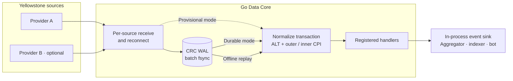

<div align="center">

# ◈ Solana Yellowstone gRPC Data Core

**A reusable, in-process Go foundation for Solana event ingestion.**

Multi-source Yellowstone gRPC · crash-aware WAL · transaction/CPI decoding · pluggable handlers

[](go.mod)
[](docs/ARCHITECTURE.md#acceptance-status)
[](LICENSE)
[](https://github.com/rpcpool/yellowstone-grpc)

**[Get started](#quick-start)** · **[Architecture](#architecture-at-a-glance)** · **[Aggregator V2 roadmap](docs/AGGREGATOR_V2_ROADMAP.md)** · **[Documentation](#documentation)** · **[Contributing](CONTRIBUTING.md)** · **[Security](SECURITY.md)**

[🇬🇧 English](docs/README.en.md) · [🇷🇺 Русский](docs/README.ru.md)

</div>

---

Solana Yellowstone gRPC Data Core receives observed Solana transactions from Yellowstone providers, persists raw updates in a per-source write-ahead log (WAL), resolves transaction and CPI positions, and forwards application-defined events through an **in-process Go API**. The included [Pump.fun CreateEvent decoder](examples/pumpfuncreate/create.go) demonstrates how to build a protocol handler.

> [!IMPORTANT]
> **Experimental v0 — observation quality is not canonical completeness.** Reconnect, WAL durability, matching providers and `finalized` commitment do **not** prove full bank or account-history coverage. Do not use this release as the sole source of exact trading balances or token state. See the [acceptance contract](docs/ARCHITECTURE.md#acceptance-status) and [open release gates](docs/TECH_DEBT.md).

## Why this core?

| Capability | What it provides |
| :--- | :--- |
| **Independent Yellowstone sources** | Configurable providers, source identity, reconnect and continuity evidence. |
| **Bounded ingestion** | A controlled receive path with queues and backpressure. |
| **Crash-aware raw WAL** | Per-source append log, CRC validation and grouped `fsync`. |
| **Transaction + CPI positions** | Loaded address table (ALT) resolution and stable outer/inner instruction indices. |
| **Pluggable decoders** | Register `Handler` implementations and deliver events to a `Sink` in the same process. |
| **Durable replay** | Reprocess persisted raw updates through the same decoder handlers. |

## Architecture at a glance



Choose **one delivery mode** per engine run: `Provisional` dispatches before source WAL durability; `Durable` dispatches after successful source WAL `fsync`. The diagram shows the available paths, not simultaneous delivery of both modes. Replay reads previously saved WAL records. [Explore the detailed architecture →](docs/ARCHITECTURE.md)

## Quick start

**Requirements:** Go 1.26.11+ and access to a Yellowstone gRPC endpoint. This source repository is public.

```bash
git clone https://github.com/sirdont0/solana-yellowstone-grpc-data-core.git
cd solana-yellowstone-grpc-data-core
cp .env.example .env
cp config.example.json config.json
```

Set your endpoint and provider token in `.env`. A token is required for the default PublicNode endpoint; other providers may permit anonymous access. The example endpoint does not guarantee the necessary filters, commitment or replay permissions. Keep credentials out of `config.json` and Git. Then:

```bash
set -a
. ./.env
set +a
go test ./...
go run ./cmd/pumpfun-create
```

To replay the locally recorded WAL using the same handler:

```bash
CORE_REPLAY_ONLY=1 go run ./cmd/pumpfun-create
```

The example writes raw data under `run/`; the directory is Git-ignored. The `.env` file must be loaded into your shell (or injected by your process manager). Replay requires WAL already captured with matching source/filter identity. [Read the complete setup guide →](docs/README.en.md#quick-start)

## Delivery and guarantees

| | Provisional | Durable | Offline replay |
| :--- | :--- | :--- | :--- |
| **Dispatch point** | On observation, before WAL `fsync` | After source WAL `fsync` | From stored WAL |
| **Latency** | Lower | Includes WAL durability cost | Offline processing |
| **Durability at dispatch** | Not guaranteed | Source WAL has been synced | Input is persisted WAL |
| **Canonical bank proof** | No | No | No |

Filtered slot sequences can legitimately skip numbers. In particular, `101 → 103 → 109` is **not sufficient** evidence of missing data. See [invariants and quality semantics](docs/ARCHITECTURE.md#invariants).

**Delivery limit:** a synced WAL does not mean that the application's `Sink` committed every event. The public API has no persisted downstream acknowledgement cursor or atomic multi-event sink transaction. On recovery, consumers must replay and deduplicate by stable event ID; exactly-once application effects and cross-source replay order are not guaranteed. Transactions without recorded CPI metadata are rejected rather than silently treated as complete.

## Documentation

| Guide | Purpose |
| :--- | :--- |
| [🇬🇧 English](docs/README.en.md) · [🇷🇺 Русский](docs/README.ru.md) | Installation, configuration, API integration and examples |
| [Architecture and invariants](docs/ARCHITECTURE.md) | End-to-end flow, evidence, delivery, boundaries and acceptance status |
| [Aggregator V2 Go/Rust roadmap](docs/AGGREGATOR_V2_ROADMAP.md) · [Русский](docs/AGGREGATOR_V2_ROADMAP.ru.md) | Go-first decision, language-neutral boundary, lifecycle, correctness and performance gates |
| [Technical debt / release gates](docs/TECH_DEBT.md) | Full-bank verification, account completeness, RPC/SQD recovery and load acceptance |
| [Public release audit](docs/PUBLIC_RELEASE_AUDIT_2026-11-14.md) | Verified hardening and remaining release conditions |
| [Contributing](CONTRIBUTING.md) | Local development, tests, PR conventions and decoder rules |
| [Security policy](SECURITY.md) | Responsible disclosure, secrets and data-integrity risks |
| [Support](SUPPORT.md) · [Code of Conduct](CODE_OF_CONDUCT.md) | Troubleshooting and community expectations |
| [Protocol provenance](PROTO_NOTICE.md) · [Third-party notices](THIRD_PARTY_NOTICES.md) | Origin and licensing of adapted Yellowstone protobuf |

## Project layout

```text
solana-yellowstone-grpc-data-core/
├── engine.go, transaction.go, replay.go    # Public Go API
├── internal/ingest/                       # Transport, WAL, source evidence
├── internal/sourcecfg/                    # Provider configuration
├── proto/                                 # Namespaced Yellowstone protobuf
├── examples/pumpfuncreate/                # Pluggable sample decoder
├── cmd/pumpfun-create/                     # Runnable demonstration
├── docs/                                   # Architecture and guides
└── .github/                                # CI, issue and PR templates
```

## Contribute and report issues

Contributions that improve testable ingest correctness, replay parity, observability, documentation and protocol decoders are welcome from repository collaborators. Read [CONTRIBUTING.md](CONTRIBUTING.md) before opening a PR. Use the [issue templates](https://github.com/sirdont0/solana-yellowstone-grpc-data-core/issues/new/choose) for reproducible bugs and proposals. For vulnerabilities, follow [SECURITY.md](SECURITY.md); do not include secrets or sensitive WAL data in issues.

## Licensing and attribution

Original Core code and documentation: [MIT](LICENSE). Adapted Yellowstone protobuf schemas and generated Go bindings: [Apache-2.0](licenses/Apache-2.0.txt), with [attribution](THIRD_PARTY_NOTICES.md) and [provenance](PROTO_NOTICE.md). The project is independently maintained and is not an official Solana, Triton One or Pump.fun SDK.
