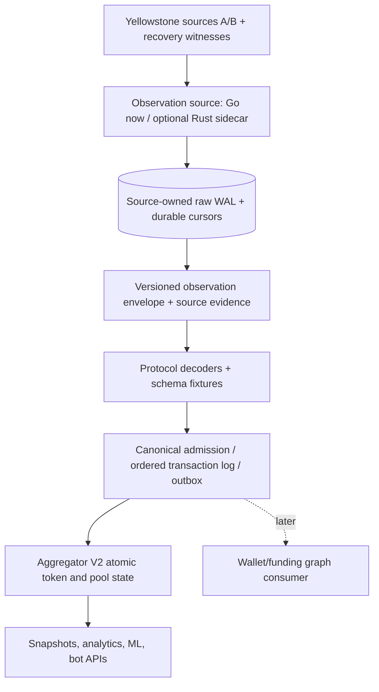

# Aggregator V2 integration roadmap — Go first, Rust optional

[← Home](../README.md) · [Русская версия](AGGREGATOR_V2_ROADMAP.ru.md) · [Core architecture](ARCHITECTURE.md) · [Technical debt](TECH_DEBT.md)

**Decision date:** 2026-11-14

**Decision status:** Accepted architectural direction; implementation milestones remain open.

**Baseline:** public Core `v0.1.0` (experimental). This document is a design and acceptance plan, not a statement that Aggregator V2 or a canonical token state engine already exists in this repository.

## ADR-001: retain Go, define a replaceable observation boundary

Keep the reusable Yellowstone Data Core and Aggregator V2 reducers in Go for now. Investigate a Rust ingest process only after representative measurements show a concrete bottleneck in the Go ingest path or a bank-aware Rust component materially reduces correctness work. Compare both implementations on **the same captured input** and the same correctness tests. No language-specific object should cross the future inter-process observation boundary.

The workload is initially **Pump.fun and PumpSwap discovery plus selective detailed state tracking**. It is not continuous ingestion of every SPL Token account on Solana. Bonding-curve tokens and active migrated pools receive more computation and targeted account observation; inactive tokens can leave RAM after a recoverable snapshot. A global program discovery stream must remain active, subject to explicit coverage evidence and provider limits. Neither the proportion of migrated tokens nor the resulting ingest rate is assumed: measure it.

Go-versus-Rust throughput is secondary to deterministic decoding, complete-enough inputs, fork handling, atomic state application, restart recovery and observable failure modes. A Rust port alone does not establish any of these properties.

## Ownership and boundaries

The picture shows target responsibilities. **Core currently implements only the Go transport, source-local WAL, basic evidence, transaction/ALT/CPI normalization, handlers and replay.** It does not implement canonical admission, accepted-bank outbox, exact protocol economics, pool state or a Rust sidecar. These belong to Aggregator V2 or separately versioned components. The existing `Handler` and `Sink` API is in-process Go; it is **not yet** a language-neutral protocol.

There are two different future contracts:

1. **Observation envelope (ingest → decoder):** versioned raw Yellowstone payload and descriptor identity; observation kind; source ID and independence/failure-domain metadata; connection generation; subscription/filter identity; commitment; source-local ordered sequence and cursor; observed time; slot and optional source-local bank ID; parent/hash if observed; payload digest and WAL reference. Transaction signature/index and account write-version fields are **optional and kind-specific**. `bank_id` and `write_version` must not be compared across different providers as global identifiers. The envelope never asserts canonical completeness.
2. **Decoded domain transaction (decoder → state):** decoder/schema version; accepted-bank identity once established; signature and transaction index when reliable; complete outer/inner instruction path and event ordinal; mint/pool; protocol event type; atomic-unit integer amounts; quote asset; raw observation references; provenance and independent coverage/quality flags. A transaction is the unit of state commit. One transaction may emit multiple domain events and affect multiple mints or pools.

Do not conflate **observation identity** (which includes source/generation) with **canonical event identity** (provider-independent, fork-aware and pinned to a decoder version). Commitment upgrades must not double-apply economics. Event IDs must be deterministic for the same accepted transaction and pinned decoder version; a schema upgrade needs an explicit migration/reprocessing policy. This future identity scheme may differ from the current Core `Event.ID` format, which includes commitment.

For a future Rust sidecar, **exactly one process owns each source connection, WAL and cursor**. Transfer bounded batches of observation envelopes over versioned protobuf/gRPC with acknowledgement of the **receiving durable boundary**. A transport ACK is not a token-state commit ACK. The Go decoder/reducer remains unchanged behind this interface. Prefer a separate process to FFI/cgo; do not introduce a Rust RPC call for every trade.

### NUMERIC-1: deterministic economic quantities

Store on-chain token quantities and lamports in their native atomic units; verify overflow on additions, products, division and fee computations. Use a wider signed integer representation (`math/big.Int` or a validated equivalent) where a derived reserve or intermediate may be negative or exceed 64 bits. Standard protobuf has **no built-in 128-bit integer**: a cross-language contract must explicitly choose canonical signed bytes or a validated decimal-string encoding, and test round trips and boundary values. Declare price/market-cap rounding rules, decimal scales, quote-asset conversion and fee liabilities. `float64` is suitable for display or selected ML features, not the accounting source of truth.

Pump coin quote dependencies, accrued protocol/creator fees, later fee sweeps and virtual reserves are separate quantities. In particular, a negative derived virtual quote reserve must not be silently clamped to zero. Pin each rule to a reviewed program/IDL version and a transaction fixture.

## Token and pool lifecycle (Aggregator V2)

| Tier | Trigger | Hot work | Exit / return |
| --- | --- | --- | --- |
| `DISCOVERY` | Mint/create observation | Small identity record and create evidence | Validated create → `CURVE_ACTIVE` |
| `CURVE_ACTIVE` | Active bonding curve | Trades, curve account, reserves, prices and behavioral windows | Verified completion → `GRADUATING`; inactivity → `COOLDOWN` |
| `GRADUATING` | Curve completed; migration may be pending | Retain hot state; observe migration, pool creation and retries | Confirmed pool bootstrap → `GRADUATED_ACTIVE` |
| `SYNTHETIC_MIGRATING` | A verified synthetic-migration path | Track its specific effects and later pool creation without replaying a prior buy | Confirmed pool bootstrap → `GRADUATED_ACTIVE`, or explicit pending/error state |
| `GRADUATED_ACTIVE` | Active PumpSwap/selected DEX pool | Pool reserves, liquidity, swaps, relevant fees, high-priority analytics | Policy-based inactivity → `COOLDOWN` |
| `COOLDOWN` | Low activity over a measured window | Compact snapshot and cheap global discovery | New relevant event → restore and catch up |
| `ARCHIVED` | Reconstructable cold history | Immutable observation history and versioned state snapshot | Selective activation and deterministic replay |

Completion and migration are distinct states; a completed curve does not prove that a tradable pool exists. In supported newer trade variants, one completing buy can emit trade, completion and post-completion effects. A later migration must not account for that buy twice. Track token lifecycle independently from each `(mint, pool)` lifecycle rather than assuming one pool per mint. A token may receive new activity after a long idle period. Eviction from RAM is permissible only after the durable source log, decoder version, state snapshot and any required catch-up range are available. Restoring a token from an incomplete history must degrade its quality, never silently mark it exact.

Global Pump.fun/PumpSwap transaction observation continues regardless of tier. Tiering limits **state and additional account-subscription costs**, not discovery fidelity or the raw ingest volume. If a holder/supply claim needs SPL/Token-2022 account writes that were not retained during cooldown, degrade that metric rather than reconstructing an invented exact ledger. Retain required quote-price dependencies. Broad wallet funding and cross-token graph traversal are deferred.

## Workstreams, dependencies and acceptance

The workstream IDs below are **not** the Aggregator V2 project phase numbers. The existing V2 plan already uses P0–P8; reusing those labels for a new Go/Rust roadmap would overwrite its acceptance history.

| Workstream / owner | Work | Acceptance evidence |
| --- | --- | --- |
| **W1 — Core reliability** | Preserve v1 WAL compatibility while introducing versioned binary protobuf segments, bounded indices and configurable retention; bounded duplicate window plus durable dedupe/accepted cursor policy; observable backpressure; snapshot + validated recovery cursor. | Clean/crash/torn-tail/disk-full/slow-sink tests; bounded memory and recovery time; every dropped/unknown interval explicitly marked. |
| **W2 — Protocol coverage** (Aggregator/decoders) | Pin real Pump.fun, PumpSwap and fee/config IDLs with fixture hashes; implement only variants confirmed by current program versions, including synthetic migration, fee sweeps, post-completion effects and quote dependencies. | Captured transaction fixtures including nested CPI, multiple effects, unknown versions and failed transactions; no silent partial economic decoding. |
| **W3 — Canonical and coverage layer** (Aggregator) | Independent full-block inclusion witness where available, source reconciliation, fork-aware admission, ordered transaction commit, durable outbox, account/config bootstrap and replay repair. Track separate transaction, account/config and price coverage. | Live/replay parity in canonical IDs, order and final state; fork rollback and missing-data fault injection; no false `EXACT` flags. |
| **W4 — State lifecycle + performance** (Aggregator/Core) | Hot/cold token tiers, recoverable snapshots, selective subscriptions, benchmark/profile Go; prioritize migrated pools. | Stable RAM across token churn; reactivation parity; 1×/3×/10× captured-load and 24-hour soak measurements with latency/GC/WAL metrics. |
| **W5 — Rust decision** (optional) | Implement a compatible Rust observation source only if evidence justifies it. | A/B on identical inputs, equivalent provenance/recovery, event and state parity, material p99/CPU/RAM or maintenance benefit. |
| **W6 — Wallet graph** (deferred) | Source-linked ownership/funding evidence and bounded k-hop temporal multigraph as a consumer of accepted events. | Independent graph quality contract; no impact on the ingest critical path. |

W2 decoding and W3 canonical work can be developed in parallel with synthetic/provisional state for testing. **Production exact state requires canonical acceptance first.** W1 is an incremental sequence of separately reviewed changes, not a one-shot WAL rewrite. In particular, existing v1 WALs need an explicit read/migration story, and retention must not discard records still needed for recovery or downstream replay.

### Alignment with the existing Aggregator V2 P0–P8 plan

At this decision date, **V2 P0 is the completed contract/field-matrix audit (`PASS`)**, not proof of runtime completeness. **V2 P1 is `BLOCKED`** on the admitted source profile and account/config closure; **V2 P2 is `PARTIAL`** on decoder/effect coverage. Retain those statuses. W1 supports V2 P1/P3/P7; W2 supports V2 P2/P5; W3 supports V2 P3/P4; W4 supports V2 P4/P5/P7. V2 P6 covers API/ML quality and data availability; P7 is fault/performance acceptance; P8 is opt-in canary and production rollout. W5 is a conditional engineering decision, not an automatic V2 phase gate. W6 remains future scope.

### Current `v0.1.0` versus target

| Capability | Current Core | Target status |
| --- | --- | --- |
| Source-local WAL | Length + CRC frames with JSON records and base64-encoded protobuf payload; grouped `fsync` | Binary/versioned segmented WAL, index, retention and compatibility tooling: **open** |
| Queues | Bounded source writer queue and bounded engine event queue | Instrument queue age/length and backpressure; prove overload behavior under stress: **partial** |
| Dedupe | Exact in-memory maps, default lifetime limit of 2,000,000; fail-closed on capacity | Bounded active-window memory with durable late-duplicate policy: **open** |
| Checkpoint | JSON diagnostic checkpoint, full WAL scan on restart | Atomic recovery snapshot + indexed incremental WAL replay: **open** |
| Replay | CRC-checked source-by-source replay, stable within-source order | Accepted canonical transaction order and downstream commit recovery: **open** |
| Completeness | Explicit `OBSERVING_UNVERIFIED` / continuity failure | Independent transaction/account/config/price coverage: **open** |
| Go ↔ Rust | Current Go API is in-process and language-specific | Versioned cross-process observation protocol: **design only** |

Do not equate `finalized`, two agreeing providers, `block_meta`, `block_footer` or a sparse increasing slot sequence with complete bank inclusion. Two connections to the same backend/operator may share a failure domain. Distinguish a skipped slot, a produced block with no matching filtered events, an unobserved block and an incomplete bank. `getBlocks` enumerates produced blocks over a range; `getBlock` can witness transaction inclusion within its supported history and access limits, but does **not** reconstruct all account writes/config evolution. RPC account reads at a commitment or with `minContextSlot` do not automatically form a single-bank, multi-account snapshot. A state bootstrap needs an independently justified bank boundary plus buffered catch-up.

`from_slot` and `SubscribeReplayInfo` are provider/version/commitment dependent; probe support, retention, errors, replay semantics and actual results for **each** subscription profile. An overlap request is a recovery attempt, not completeness proof. A successful transaction repair can advance a `TX_REPAIRED` assessment; it cannot automatically advance `ACCOUNT_HISTORY_VERIFIED` or `CONFIG_VERIFIED`. When full account history cannot be recovered, a documented `NEW_BASELINE` begins a new coverage epoch and must not retroactively claim previous completeness. Narrow `getSignaturesForAddress` repairs may help but also need independent inclusion and account-history checks.

Keep the **source evidence/recovery cursor** separate from **accepted application state**. An ingest restart creates a new observation session generation. Any state snapshot may be used as an acceleration artifact only when the accepted commit log, state/schema version, snapshot hash and replay cursor can be validated; otherwise rebuild rather than trusting stale native state. This preserves the existing V2 restart-epoch contract.

## Measurements and release gates

Use sanitized 10–30 minute real captures plus burst fixtures, fixed transaction ordering and recorded decoder versions. Test 1×/3×/10× observed peak input, restarts, forced disconnects, slow consumers, queue saturation, disk-full, torn/corrupt WAL, overlapping replay, forks and provider disagreement. A 24-hour soak is required before an operational durability claim.

Record input MiB/s, observations/s, received-to-`fsync` p50/p95/p99, received-to-provisional p99, oldest queue age, replay catch-up rate, WAL bytes/day, CPU, GC CPU, allocations/event, RSS, continuity breaks, and missing/late observations. For historical ML features record event time, source `observed_at`, downstream `known_at` and recovery time: a backfilled trade was **not** available to the live model during a prior outage. Validate time-aware replay without lookahead. Correctness gates take precedence over throughput. The target SLO must be set from the consuming trading/analytics workload; avoid an arbitrary claim that Go or Rust is faster.

The **Core release gates** are tracked in [Technical debt](TECH_DEBT.md). The **Aggregator V2 acceptance gate** additionally requires deterministic atomic multi-mint state updates, lifecycle reactivation parity, protocol economics validation and independent coverage evidence. This document does not change `v0.1.0` API or promise these features today.

## Primary references

- [Yellowstone gRPC](https://github.com/rpcpool/yellowstone-grpc) — protocol, client and replay capabilities.
- [Pump public IDLs](https://github.com/pump-fun/pump-public-docs/tree/main/idl) — pin reviewed versions rather than guessing instruction names.
- [Pump synthetic migration](https://github.com/pump-fun/pump-public-docs/blob/main/docs/SYNTHETIC_MIGRATION.md) and [quote dependency](https://github.com/pump-fun/pump-public-docs/blob/main/docs/instructions/CREATE_WITH_PUMP_COIN_QUOTE.md) — relevant lifecycle cases; confirm against pinned on-chain programs.
- [Shipstern](https://github.com/solana-rpc/shipstern), [Carbon](https://github.com/sevenlabs-hq/carbon), [Solana Microscope](https://github.com/solana-foundation/solana-microscope) — candidates for evaluation, **not adopted dependencies**. Shipstern's bank-aware coordinator has input/commitment assumptions that must be checked against the chosen provider; it is not a drop-in replacement for a finalized-only stream.
- [Go GC guide](https://go.dev/doc/gc-guide) — measure allocation/GC behavior before choosing a language migration.
