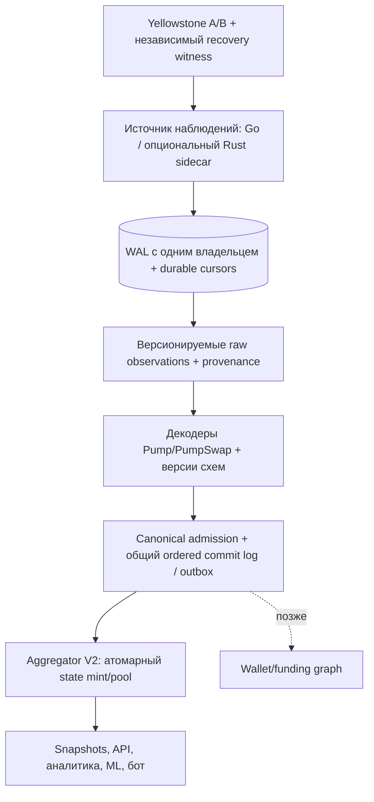

# Aggregator V2 — архитектура Go/Rust и план интеграции

[← Главная](../README.md) · [English](AGGREGATOR_V2_ROADMAP.md) · [Архитектура Core](ARCHITECTURE.md) · [Технический долг](TECH_DEBT.md)

**Дата решения:** 14.11.2026. **Статус:** архитектурное направление принято; этапы реализации открыты. **База:** публичный экспериментальный Core `v0.1.0`. Это план развития, а не утверждение о наличии готового Aggregator V2 или канонического token state в этом репозитории.

## ADR-001: оставляем Go и проектируем заменяемый источник наблюдений

Сейчас **не переписываем Yellowstone Data Core на Rust**. Go остаётся языком ingestion, декодирования и state reducers. Rust возможен позднее в виде отдельного процесса, если профилирование покажет конкретный bottleneck в Go или готовый bank-aware компонент заметно уменьшит объём работы над корректностью. Решение принимается только по A/B-прогону на **одинаковом записанном потоке**, с одинаковыми проверками корректности.

Наша начальная нагрузка — глобальное обнаружение событий **Pump.fun/PumpSwap** и выборочная детальная обработка активных bonding curves и пулов после миграции. Это существенно уже, чем подписка на все SPL Token accounts сети. Неактивные токены могут покидать RAM после надёжного snapshot; при новой активности они должны восстановиться с catch-up. Доля migrated токенов и реальные bursts ещё должны быть измерены.

Сам переход на Rust не обеспечивает полноту входных данных, правильный порядок транзакций, обработку форков, атомарность применения изменений или восстановление после сбоя. Для достоверного агрегатора эти свойства первичны.

## Границы ответственности

**Что действительно есть в Core v0.1.0:** Go transport/reconnect, source-local WAL, наблюдения о качестве, нормализация транзакций/ALT/CPI, обработчики и offline replay. **Чего ещё нет:** полного canonical admission, принятого банка, atomic downstream outbox, точной экономической модели Pump, актуального token/pool state, Rust sidecar и межъязыкового protobuf-контракта. Domain reducers и lifecycle принадлежат Aggregator V2 или самостоятельным protocol packages.

Разделяем две будущие схемы:

1. **Observation envelope** между ingest и decoder: версия контракта и protobuf descriptor; тип raw обновления; `source_id`, независимый failure domain, `connection_generation`, идентичность фильтра, commitment, время наблюдения, slot, локальная последовательность/курсор, digest и WAL reference. `bank_id` допустим только как source-local hint; сигнатура/index и account `write_version` опциональны и зависят от вида обновления. Никаких обещаний canonical completeness.
2. **Decoded domain transaction** между decoder и state: версия декодера и экономической схемы; accepted bank identity после проверки; сигнатура/index, точный путь outer/inner CPI, ordinal события, mint/pool, тип операции, суммы в **целых atomic units**, quote asset, raw reference и отдельные quality flags. **Единица коммита — вся транзакция**, которая может затрагивать несколько mint/pool.

ID наблюдения зависит от источника/поколения соединения. ID канонического события должен быть независим от провайдера, учитывать fork/принятый банк и фиксированную версию декодера. Изменение версии декодера требует явной политики переобработки. Повышение commitment не должно повторно менять экономическое состояние. Текущий `Event.ID` в Go Core содержит commitment; это **не готовый canonical event ID**.

Если появится Rust sidecar, **ровно один процесс** владеет каждым source connection, WAL и cursor. Он передаёт пачки raw observations по версионируемому protobuf/gRPC и получает ACK конкретной durable границы. ACK транспорта не означает успешный commit token state. Go-декодеры и reducers остаются независимыми. FFI/cgo и RPC на каждый trade не нужны.

### NUMERIC-1: точность экономического state

On-chain количества токенов и lamports храним в **целых atomic units**. При сложении, умножении, делении и расчётах комиссий проверяем переполнение. Для signed derived reserves и промежуточных чисел шире 64 бит нужен `math/big.Int` либо проверенная широкая арифметика. В стандартном protobuf **нет встроенного `i128`**: межъязыковая схема должна явно задавать каноническое представление signed bytes или проверенной decimal string с тестами граничных значений. Фиксируем правила округления цены/market cap/FDV, масштаб decimals, quote conversion и задолженность по комиссиям. `float64` допустим для отображения и отдельных ML-признаков, но не как источник истины ledger.

Quote dependencies на Pump coin, накопленные protocol/creator fees и последующие sweeps, virtual reserves и используемые для pricing величины храним отдельно. Отрицательный вычисленный virtual quote reserve нельзя молча обнулять. Каждую формулу привязываем к версии on-chain программы/IDL и проверенному fixture.

## Lifecycle токенов и пулов

| Tier | Основание | Что делаем | Переход |
| --- | --- | --- | --- |
| `DISCOVERY` | Новый mint/create | Компактный identity и create evidence | Валидированный create → `CURVE_ACTIVE` |
| `CURVE_ACTIVE` | Активная bonding curve | Торги, curve account, резервы, цены, признаки | Подтверждённое завершение → `GRADUATING`; затишье → `COOLDOWN` |
| `GRADUATING` | Curve завершена, миграция ещё не гарантирована | Сохраняем hot state, следим за migration, pool creation, повторами | Подтверждённый bootstrap пула → `GRADUATED_ACTIVE` |
| `SYNTHETIC_MIGRATING` | Подтверждённый путь synthetic migration | Учитываем специфические эффекты и создание пула, не дублируя старую покупку | Bootstrap пула → `GRADUATED_ACTIVE` либо явный pending/error |
| `GRADUATED_ACTIVE` | Активный PumpSwap/выбранный DEX pool | Высокий приоритет резервов, ликвидности, swaps, fees | Продолжительный простой → `COOLDOWN` |
| `COOLDOWN` | Низкая активность | Snapshot, дешёвый глобальный discovery | Новое событие → восстановление + catch-up |
| `ARCHIVED` | Холодная история, которую можно восстановить | Durable history + версионируемый snapshot | Выборочная реактивация |

**Curve Complete и созданный торгуемый пул — разные состояния.** В актуальных вариантах завершающая покупка может породить сразу trade, completion и post-completion effects; последующая миграция не должна повторно учитывать ту же покупку. Lifecycle токена и каждого `(mint, pool)` ведём отдельно. Удаление из RAM допустимо только при сохранённых WAL/истории, версии декодера, snapshot и необходимом catch-up диапазоне. Если покрытие истории неполное, реактивированный token state получает соответствующий quality status.

Глобальная подписка на Pump.fun/PumpSwap продолжает обеспечивать discovery независимо от tier. Тиринг уменьшает стоимость **дополнительных подписок и reducer-вычислений**, но не базовый объём глобального ingest. Если точный holder/supply ledger зависит от SPL/Token-2022 account writes, которые не сохранялись во время cooldown, качество этих метрик понижаем, а не выдумываем восстановленную полноту. Сохраняем и нужные quote-price dependencies. Граф финансирования кошельков отложен.

## Направления работ и связь с этапами V2

Ниже обозначения **W1–W6** — это независимые направления работ, **не** номера этапов Aggregator V2. В действующем плане V2 уже существуют P0–P8; перенумеровывать их новым Go/Rust roadmap нельзя.

| Направление | Задача | Критерий приёмки |
| --- | --- | --- |
| **W1 — Core reliability** | Версионируемые бинарные protobuf WAL segments с совместимостью v1, индексом и retention; ограниченная память дедупликации с устойчивой политикой late duplicates; метрики backpressure; snapshot с проверенным recovery cursor. | Crash/torn-tail/disk-full/slow-sink, bounded RAM и recovery time; без молчаливых потерь. |
| **W2 — Pump protocol** | Зафиксировать реальные версии Pump.fun/PumpSwap/Fee IDL и fixtures; декодировать только подтверждённые варианты, включая synthetic migration, fee sweeps, post-completion events и quote dependencies. | Вложенные CPI, multi-event и failed transactions; неизвестная версия не превращается в «полные» данные. |
| **W3 — Canonical layer** | Независимое подтверждение tx inclusion, fork-aware admission, общий ordered transaction commit/outbox, bootstrap account/config state, RPC repair, coverage frontiers. | Live/replay дают одинаковые canonical IDs, порядок и финальный state; откат fork и инъекции пропусков не дают ложного `EXACT`. |
| **W4 — Hot/cold + Go performance** | Тиринг, reactivation, profiling Go, оптимизация batch/allocations и приоритет migrated pools. | Предсказуемый RAM при churn токенов; тесты 1×/3×/10×, 24h soak, latency/GC/WAL метрики. |
| **W5 — Rust по результатам измерений** | Прототип совместимого `ObservationFeed`, только если он оправдан. | A/B одного dataset, correctness parity и измеримая выгода по p99/CPU/RAM или поддержке. |
| **W6 — Wallet graph** | Позже: funding SOL/USDC, ownership hypotheses, временной ориентированный multigraph и ограниченная глубина обхода. | Отдельный quality contract, вне critical path ingest. |

W2 и W3 можно разрабатывать параллельно с **provisional** состоянием для экспериментов, но **точное производственное состояние нельзя объявлять до принятия canonical layer**. W1 внедряется небольшими совместимыми изменениями; старые `journal.wal` нельзя просто переписать или удалить. Retention должен учитывать восстановление и downstream replay.

### Привязка к действующему Aggregator V2 P0–P8

На дату решения **V2 P0 — `PASS`** означает завершение контракта и матрицы полей, а не доказанную runtime полноту. **V2 P1 — `BLOCKED`** по профилю источников и закрытию account/config history; **V2 P2 — `PARTIAL`** по декодерам и effects. Эти статусы сохраняем. W1 относится к V2 P1/P3/P7; W2 — к P2/P5; W3 — к P3/P4; W4 — к P4/P5/P7. V2 P6 отвечает за API/ML quality и время доступности данных, P7 — fault/performance acceptance, P8 — opt-in canary и rollout. W5 — условное архитектурное решение, W6 — отложенное направление.

## Реальное состояние Core v0.1.0

| Механизм | Есть сейчас | Что требуется |
| --- | --- | --- |
| WAL | Бинарные length/CRC frames, но внутри JSON + protobuf как base64; групповой `fsync` | Сегменты с бинарным raw payload, индекс, migration/read v1 |
| Очереди | Bounded source writer и engine event queues | Метрики длины/возраста очереди, нагрузочные и fault tests |
| Dedupe | Exact in-memory maps, пожизненный лимит по умолчанию 2 млн; overflow завершает поток | Bounded active window + durable политика поздних дублей |
| Checkpoint | JSON с состоянием наблюдения; при старте весь WAL читается заново | Atomic snapshot + индексированный incremental recovery |
| Replay | CRC и порядок внутри источника, source-by-source | Общий принятый порядок транзакций и downstream ack |
| Полнота | `OBSERVING_UNVERIFIED` и явные continuity breaks | Независимые tx/account/config/price coverage |
| Go/Rust | Только Go API внутри процесса | Межпроцессный versioned observation protocol, пока лишь проект |

`finalized`, два согласных провайдера, `block_meta`, `block_footer` и возрастающие **разреженные слоты** сами по себе не подтверждают полный банк. Два соединения одного оператора могут иметь общий failure domain. Различаем пропущенный лидером слот, произведённый блок без подходящих событий, неполученный блок и неполный bank. `getBlocks` перечисляет произведённые блоки, а `getBlock` может проверить доступные транзакции, но **не восстанавливает историю всех account writes и config changes**. Даже серия `getMultipleAccounts` с commitment или `minContextSlot` не гарантирует единый snapshot всех аккаунтов на одном bank; bootstrap должен иметь обоснованную точку среза и buffered catch-up.

`from_slot` и `SubscribeReplayInfo` зависят от версии, commitment и прав провайдера. Проверяем каждый профиль подписки, retention, семантику replay, ошибки и overlap. Результат `TX_REPAIRED` не даёт автоматически `ACCOUNT_HISTORY_VERIFIED` или `CONFIG_VERIFIED`. Если старую историю аккаунта восстановить нельзя, фиксируем `NEW_BASELINE` с новым coverage epoch, не переписывая задним числом качество старого интервала. `getSignaturesForAddress` полезен для узкого repair, но сам не доказывает полноту.

Разделяем **source recovery cursor** и **accepted application state**. После ingest restart начинается новое поколение наблюдений. Snapshot состояния может ускорять восстановление только при проверенном accepted commit log, версии state/schema, хеше snapshot и курсоре replay. Иначе state пересчитывается, чтобы не нарушить действующий V2 контракт новых session epochs.

## Нагрузочные и correctness gates

Собрать обезличенные реальные protobuf captures 10–30 минут плюс отдельные bursts, закрепить версии декодеров. Проверить 1×/3×/10× observed peak, restart, forced disconnect, очередь с медленным consumer, полный диск, torn/corrupt WAL, overlap/replay, fork и противоречивые источники. Перед заявлениями об эксплуатационной надёжности нужен минимум 24h soak.

Измерять input MiB/s и events/s, `receive→fsync` p50/p95/p99, `receive→provisional` p99, возраст самой старой записи в очереди, скорость catch-up, WAL GB/day, CPU/GC, allocations/event, RSS, пропущенные/поздние события и continuity breaks. Для ML отдельно храним время события, `observed_at`, `known_at` и время backfill: исторически восстановленная транзакция **не была известна торговой модели** во время обрыва. Проверяем отсутствие lookahead. Пороговые SLO задаются реальным потребителем и измеряются на одинаковых данных. Нельзя выбирать Rust по общей репутации языка.

Core release gates перечислены в [Technical debt](TECH_DEBT.md). Для Aggregator V2 дополнительно нужны атомарное применение multi-mint транзакций, восстановление cold state, проверка экономических формул и отдельное доказательство coverage. Этот документ не меняет текущий API `v0.1.0`.

## Источники для проверки

- [Yellowstone gRPC](https://github.com/rpcpool/yellowstone-grpc)
- [Pump публичные IDL](https://github.com/pump-fun/pump-public-docs/tree/main/idl), [synthetic migration](https://github.com/pump-fun/pump-public-docs/blob/main/docs/SYNTHETIC_MIGRATION.md), [quote dependency](https://github.com/pump-fun/pump-public-docs/blob/main/docs/instructions/CREATE_WITH_PUMP_COIN_QUOTE.md)
- [Shipstern](https://github.com/solana-rpc/shipstern), [Carbon](https://github.com/sevenlabs-hq/carbon), [Solana Microscope](https://github.com/solana-foundation/solana-microscope) — кандидаты для изучения, пока не зависимости проекта. Требования Shipstern к входным bank-aware данным и commitment нужно проверить на реальном provider; это не drop-in замена finalized-only стрима.
- [Go GC guide](https://go.dev/doc/gc-guide)
