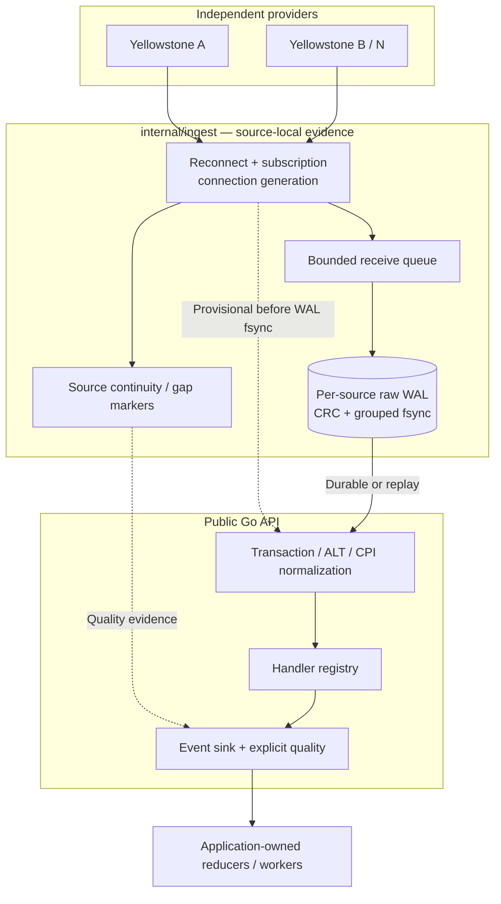
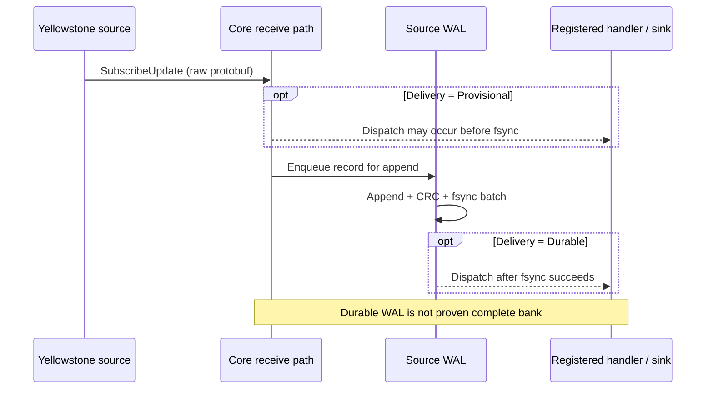

# Architecture and acceptance contract

[← Home](../README.md) · [🇬🇧 English](README.en.md) · [🇷🇺 Русский](README.ru.md) · [Aggregator V2 roadmap](AGGREGATOR_V2_ROADMAP.md) · [Technical debt](TECH_DEBT.md)

The goal is a reusable Solana event foundation consumed as a Go library by
Aggregator V2, the trading bot and future indexing tools.

## Component map

The paths are conceptual. Each source has its own receive/WAL lifecycle; the
diagram merges them to make the public API boundary visible. An engine run
selects either Provisional or Durable delivery, and replay is a separate call.

## Dispatch timeline

**Replay:** `Engine.Replay` reads each source WAL with CRC validation and calls
the registered handlers again. It preserves order within a source WAL, not the
original cross-source interleaving.

## Package boundaries

| Package or file | Owns |
| :--- | :--- |
| `engine.go` | Source orchestration, handler registration and event sink |
| `transaction.go` | Raw Yellowstone transaction normalization and instruction positions |
| `replay.go` | Strict WAL replay through the same dispatch path |
| `internal/ingest` | Reconnect, bounded ingestion, WAL and source-local evidence |
| `internal/sourcecfg` | Source configuration validation and loading |
| `examples/pumpfuncreate` | Example protocol-specific CreateEvent decoding |

Protocol economics, canonical token state, market history, account ownership
and trading execution remain application responsibilities.

The accepted Go-first integration decision and proposed language-neutral
observation boundary are detailed in the [Aggregator V2 roadmap](AGGREGATOR_V2_ROADMAP.md).
The boundary is **not implemented** by this release: the public API still
passes Go types within one process. A future Rust sidecar must preserve the
same source evidence and WAL ownership semantics without claiming canonical
state from transport acknowledgements.

There is no additional network hop between the Go engine and application
decoders. Source and application configuration are separate. For throughput,
applications should keep handler work brief and hand data to bounded
application-owned workers; Core itself never invents business events.

## Invariants

1. A connection, `block_meta`, `block_footer` or ping proves neither complete
   bank inclusion nor complete account history. Sparse filtered slots do not
   imply a gap.
2. Source-local `bank_id` and `write_version` are not comparable across
   backends. Transaction identity spans finalized slot, index and signature;
   conflicting copies stop dispatch rather than silently combining.
3. Every raw update is either durably appended in receive order or its stream
   fails closed. WAL torn tails and CRC errors are reported.
   Once `Recv` succeeds, graceful cancellation drains the accepted update
   through the source WAL writer; a terminal writer error is surfaced rather
   than retried indefinitely. An incompatible subscription identity is
   rejected for an existing WAL directory; use a new directory or explicit
   migration to avoid mixing historical filters.
4. `Provisional` events may precede WAL durability. `Durable` events are
   emitted only after the source WAL reports successful fsync.
   Neither mode records downstream sink acknowledgements: a crash can leave
   durable WAL records undelivered, and retry can duplicate partially applied
   sink effects. Consumers need idempotent event IDs and their own commit/recovery protocol.
5. All published events retain source, commitment, source generation, tx/CPI
   positions and explicit quality. No present mode labels them exact.
6. A handler cannot mutate the engine's raw payload or return claims of bank
   completeness; correctness and quality remain separate concerns.

## Existing code boundaries

Only the independent Yellowstone lab's universal transport, WAL, source
configuration, instruction position and evidence code was extracted. Original
Aggregator V2 sources and business reducers remain intact. They contain
uncommitted and experimental work that must not be deleted during extraction.

`internal/aggregatorv2/reducer`, token holders/supply, pool inventory, market
history, currency normalization, metadata and trading adapters belong to
Aggregator V2 or additional protocol packages, not this engine.

## Acceptance status

- Source-local transport/reconnect/WAL/CPI extraction: **tested** in the
  standalone module and inherited lab tests.
- Batch fsync/receive decoupling: **implemented**, with local regression tests;
  live load/performance acceptance remains open.
- Durable batch prefix delivery on dedupe conflict, cancellation drain and
  terminal writer error propagation: **implemented and regression-tested**;
  persistent downstream acknowledgement remains open.
- Cross-source duplicate suppression of emitted transactions: **implemented**
  for observed identical finalized identities; no bank-completeness proof.
- Canonical bank acceptance and completeness oracle: **unverified**.
- Account/config lifecycle completeness: **unverified**.
- Full ordered protocol economic effects: **out of scope**.
- RPC/SQD repair: **deferred technical debt**.

Do not switch a production trading or ML exact state pipeline onto this Core
until a separate accepted canonical completeness contract exists. The current
Aggregator V2 P1 and P2 audits retain their BLOCKED/PARTIAL status.
