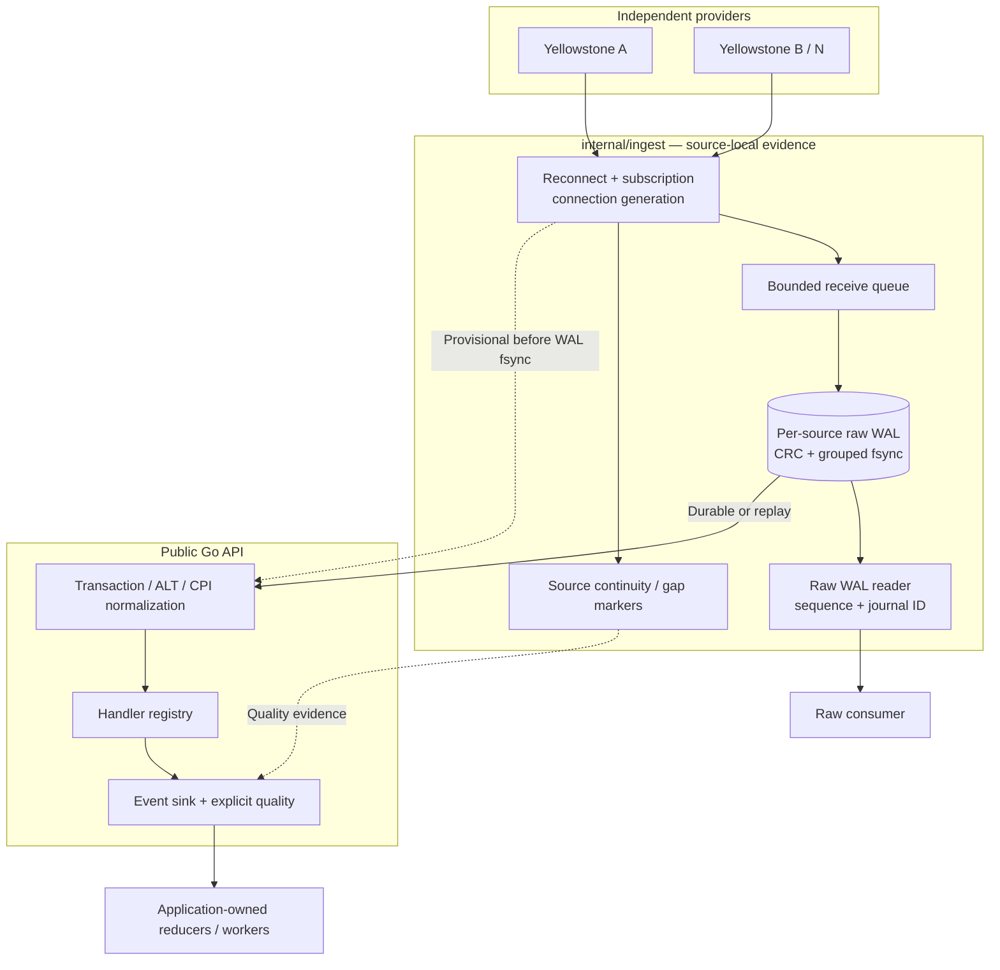
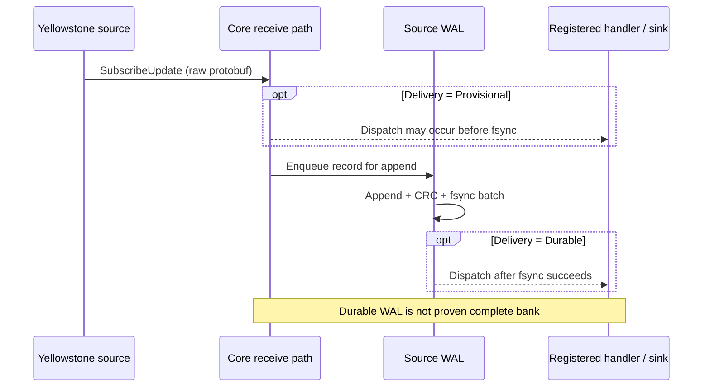

# Architecture and acceptance contract

> **Scope navigation (2026-11-19):** Accepted product boundaries and four ADRs are in [PROJECT_SCOPE.md](PROJECT_SCOPE.md), source/cursor semantics in [SOURCE_CONTRACT.md](SOURCE_CONTRACT.md), provider compatibility in [PROVIDER_MATRIX.md](PROVIDER_MATRIX.md), downstream test/SLO expectations in [CONSUMER_ACCEPTANCE_AND_SLO.md](CONSUMER_ACCEPTANCE_AND_SLO.md), and current acceptance gates in [RELEASE_GATES.md](RELEASE_GATES.md). This document describes the implementation and invariants; the extra documents distinguish present features from future acceptance.

[← Home](../README.md) · [🇬🇧 English](README.en.md) · [🇷🇺 Русский](README.ru.md) · [Aggregator V2 roadmap](AGGREGATOR_V2_ROADMAP.md) · [Technical debt](TECH_DEBT.md)

The goal is a reusable Solana event foundation consumed as a Go library by
Aggregator V2, the trading bot and future indexing tools.

## Component map

The paths are conceptual. Each source has its own receive/WAL lifecycle; the
diagram merges them to make the public API boundary visible. An engine run
selects either Provisional or Durable delivery, and replay is a separate call.

## Dispatch timeline

**Replay:** `Engine.Replay` reads each source WAL with CRC validation and calls
the registered handlers again. It preserves order within a source WAL, not the
original cross-source interleaving.

## Raw observation boundary

`NewRaw` creates an engine that persists every update selected by the supplied
Yellowstone `SubscribeRequest` without invoking transaction, ALT or CPI
normalization. `Source.Subscription` can select transaction, transaction
status, account, slot, block-meta, block, entry, block-footer and other
supported Yellowstone filters. The protobuf filter object is cloned; the engine owns `commitment`,
`from_slot` and ping fields. The complete normalized subscription is hashed
into the WAL identity, so changing any filter requires a separate data
directory or an explicit migration.

On reconnect, the Core chooses the minimum observed slot frontier across all
update classes explicitly requested by a custom subscription. A class with no
observed slot keeps the automatic frontier at zero; progress from an unrelated
class is never used to advance it. If no class-specific frontier is available,
the Core uses only an explicitly configured initial `FromSlot` or starts live
from the provider head, while retaining the continuity-break marker. This is a
conservative replay cursor, not proof that the provider retained or returned
every matching update. `SubscribeReplayInfo` is advisory; provider replay
support and historical coverage remain endpoint-specific.

`OpenRawReader(source, cursor)` tails only records already fsynced to that
source WAL. It uses a bounded `Next(ctx, limit)` API and can continue from a
cursor after reconnect or process restart. A cursor is the tuple
`source + subscription identity + journal ID + sequence`; sequence is
monotonic within one WAL and does not imply order across sources. The journal
ID changes when a WAL is recreated, so stale cursors fail with
`ErrCursorExpired` rather than silently skipping new records. `ReadRaw` is the
offline catch-up helper after `Run` has stopped.

Consumers may persist their progress with `Ack(consumer, cursor)`. The ACK file
is atomically replaced and fsynced, is monotonic, and is scoped per consumer
and source. Commit the consumer's own database transaction before calling
`Ack`. A crash between that commit and the ACK intentionally redelivers the
observation; this is at-least-once delivery, not an atomic or exactly-once
cross-system transaction. WAL retention/compaction based on consumer ACKs is
not implemented yet.
`ConsumerLag(consumer, source)` exposes WAL-record backlog relative to the
durable ACK, including lifecycle markers, and the oldest pending record age.
Its age histogram records one sample of the oldest pending record each time
the method is called; it does not scan every unacknowledged record. Samples
are process-local and bounded to 1,024 active consumer/source pairs.
Cross-instance ACK read/compare/write uses a stable sibling lock file on supported Unix
platforms. Offline readers can seek using a best-effort `.sidx` cache written at
clean WAL close; stale/malformed caches are ignored and WAL data remains
authoritative.

The raw envelope carries the receive timestamp, provider `created_at` when
present, slot, transaction index, signature, account/write-version and
optional bank-ID presence. `Payload` is the protobuf update re-serialized
after gRPC decoding, not the original network frame. `Failed` and fee metadata
are exposed when transaction metadata is present. This keeps failed
transaction fees observable even though the default transaction filter still
excludes failed transactions; a custom filter can leave `Failed` unset to
include both outcomes.

Program handlers are admitted only for `finalized` sources. `processed` and
`confirmed` streams remain available through the raw API and are treated as
source-local observations: competing forks at one slot do not become shared
bank conflicts or transaction dedupe conflicts. A consumer that needs
canonical effects must build a separate finalized admission layer.

The receive-to-WAL writer and the post-WAL dispatch queue have byte budgets in
addition to item limits. Defaults are 128 MiB per source writer, 256 MiB for
the shared dispatch queue and 16 MiB per fsync batch. Queue byte usage and
limits plus last/total/max WAL sync duration and sync count are exposed through
`Health`. These are retained-payload bounds, not a hard process RSS limit.
`MaxMessageMiB` is capped at 95 because WAL v1 stores a
base64 JSON envelope inside a 128 MiB frame. Graceful shutdown keeps sink
delivery alive for up to `ShutdownTimeout` (15 seconds by default); timeout
cancels the delivery context and returns `ErrDrainTimeout`. A sink that ignores
context cannot be forcibly interrupted.

## Package boundaries

| Package or file | Owns |
| :--- | :--- |
| `engine.go` | Source orchestration, handler registration and event sink |
| `transaction.go` | Raw Yellowstone transaction normalization and instruction positions |
| `replay.go` | Strict or explicitly tolerant-tail WAL replay through the same dispatch path |
| `internal/ingest` | Reconnect, bounded ingestion, WAL and source-local evidence |
| `internal/sourcecfg` | Source configuration validation and loading |
| `examples/pumpfuncreate` | Example protocol-specific CreateEvent decoding |

Protocol economics, canonical token state, market history, account ownership
and trading execution remain application responsibilities.

The accepted Go-first integration decision and proposed language-neutral
observation boundary are detailed in the [Aggregator V2 roadmap](AGGREGATOR_V2_ROADMAP.md).
The boundary is **not implemented** by this release: the public API still
passes Go types within one process. A future Rust sidecar must preserve the
same source evidence and WAL ownership semantics without claiming canonical
state from transport acknowledgements.

There is no additional network hop between the Go engine and application
decoders. Source and application configuration are separate. For throughput,
applications should keep handler work brief and hand data to bounded
application-owned workers; Core itself never invents business events.

## Invariants

1. A connection, `block_meta`, `block_footer` or ping proves neither complete
   bank inclusion nor complete account history. Sparse filtered slots do not
   imply a gap.
2. Source-local `bank_id` and `write_version` are not comparable across
   backends. Transaction identity spans finalized slot, index and signature;
   conflicting copies stop dispatch rather than silently combining.
3. Every raw update accepted by `Recv` is either durably appended in receive
   order or its stream fails closed. WAL torn tails and CRC errors are
   reported. A byte budget bounds retained source-queue payloads. An
   incompatible subscription identity is rejected for an existing WAL
   directory; use a new directory or explicit migration to avoid mixing
   historical filters.
4. `Provisional` events may precede WAL durability. `Durable` events are
   emitted only after the source WAL reports successful fsync.
   The raw observation API has durable source-local ACK cursors, but they are
   not atomic with an external sink/database transaction. Commit application
   effects before ACK; a crash between them can cause redelivery. Handler
   delivery still requires an application-owned commit/recovery protocol.
5. All published events retain source, commitment, source generation, tx/CPI
   positions and explicit quality. No present mode labels them exact.
6. A handler cannot mutate the engine's raw payload or return claims of bank
   completeness; correctness and quality remain separate concerns.

## Existing code boundaries

Only the independent Yellowstone lab's universal transport, WAL, source
configuration, instruction position and evidence code was extracted. Original
Aggregator V2 sources and business reducers remain intact. They contain
uncommitted and experimental work that must not be deleted during extraction.

`internal/aggregatorv2/reducer`, token holders/supply, pool inventory, market
history, currency normalization, metadata and trading adapters belong to
Aggregator V2 or additional protocol packages, not this engine.

## Acceptance status

- Source-local transport/reconnect/WAL/CPI extraction: **tested** in the
  standalone module and inherited lab tests.
- Batch fsync/receive decoupling: **implemented**, with local regression tests;
  live load/performance acceptance remains open.
- Raw-only subscription and WAL-tail API for transactions, statuses, accounts,
  slots, block metadata, blocks, entries and block footers: **implemented and
  regression-tested**. Reconnect frontiers are tracked per requested update
  class; provider replay availability and historical completeness remain
  endpoint-specific.
- Source-local sequence/journal cursors and durable per-consumer ACK files:
  **implemented** with at-least-once semantics; retention/compaction and
  atomic application-database ACK remain open.
- Source and dispatch byte budgets plus bounded shutdown drain:
  **implemented and regression-tested**; fsync-latency, oldest-queue-age and
  sustained provider-load acceptance remain open.
- Durable batch prefix delivery on dedupe conflict, cancellation drain and
  terminal writer error propagation: **implemented and regression-tested**;
  atomic downstream acknowledgement remains application-owned.
- Cross-source duplicate suppression of emitted transactions: **implemented**
  for observed identical finalized identities; no bank-completeness proof.
- Canonical bank acceptance and completeness oracle: **unverified**.
- Account/config lifecycle completeness: **unverified**.
- Full ordered protocol economic effects: **out of scope**.
- RPC/SQD repair: **deferred technical debt**.

Do not switch a production trading or ML exact state pipeline onto this Core
until a separate accepted canonical completeness contract exists. The current
Aggregator V2 P1 and P2 audits retain their BLOCKED/PARTIAL status.

## Audit follow-up API

See [2026-11-15 audit](AUDIT_CLOSURE_2026-11-15.md) for `SkipAndFlag`,
`ReplayWithOptions`, reconnect controls and durable evidence snapshots.
Both public transaction decoding and internal occurrence extraction use the
same normalizer. Unrecorded CPI remains unknown; known-empty CPI is accepted.
An isolated handler error discards all prepared effects for that transaction.
Registration and session start are serialized. Replay locks and preflights all
source WALs before invoking handlers and does not repair files in place.
