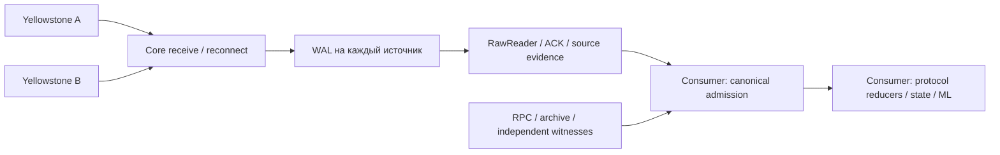

# Public Yellowstone Data Core — цели и границы

**Статус:** согласованный архитектурный контракт; реализация отдельных требований ещё не завершена.
**Дата решения:** 2026-11-19.
**Область:** публичный `github.com/sirdont0/solana-yellowstone-grpc-data-core`, ветка `dev`.

Этот документ определяет, **что обязан делать публичный Core**, независимо от конкретного Solana-протокола. Текущие возможности перечислены в [ARCHITECTURE.md](ARCHITECTURE.md), открытые работы — в [ROADMAP.md](ROADMAP.md), количественные требования для следующих модулей — в [CONSUMER_ACCEPTANCE_AND_SLO.md](CONSUMER_ACCEPTANCE_AND_SLO.md).

## Цель продукта

Переиспользуемая Go-библиотека для приёма выбранных Yellowstone gRPC updates от одного или нескольких провайдеров, сохранения в независимых source-local WAL, восстановления после сбоев и предоставления потребителям проверяемых наблюдений с provenance, курсорами и явным качеством покрытия. Поддерживаются как универсальный raw API, так и опциональные decoder/handler API.

Критический инвариант: **наблюдение, долговечность записи и полнота канонической цепочки — три разные гарантии**. `finalized`, `block_meta`, `block_footer`, одинаковые события A/B и WAL `fsync` сами по себе не доказывают полноту блока, истории account writes или конфигурации.

## Утверждённые решения

| ADR | Решение | Последствие |
| --- | --- | --- |
| [ADR-0001](ADR/0001-core-boundary.md) | Core — универсальный транспорт, durable raw observations и source evidence; экономическая модель токена живёт у потребителя. | Нет обязательных Pump.fun/PumpSwap reducer, RPC/SQD backfill или ML в ядре. |
| [ADR-0002](ADR/0002-multisource.md) | A/B — независимые потоки и независимые журналы; не существует обещанного общего порядка по времени приёма. | Потребитель отдельно согласует банки, порядок и полноту, учитывая независимость failure domains. |
| [ADR-0003](ADR/0003-wal-policy.md) | WAL v1 остаётся форматом по умолчанию; v2 — экспериментальный opt-in до acceptance. | Совместимость, явная миграция, отсутствие автоматического удаления истории. |
| [ADR-0004](ADR/0004-commitment.md) | Базовый контракт для корректного downstream state ориентирован на `finalized`; быстрые `processed` наблюдения допускаются отдельно. | Оптимистическое состояние и rollback не выдаются за готовую возможность Core. |

## Границы ответственности

**Core владеет:** конфигурацией и идентичностью подписок, reconnect и явными маркерами качества, локальным порядком приёма, WAL integrity/durability, исходным protobuf payload после gRPC decoding, dedupe политики источника, bounded queues, durable source-local cursors и ACK, метриками и source evidence. Любое поведение должно быть воспроизводимо по записанным данным и сигнализировать о потере уверенности.

**Потребитель владеет:** проверкой полноты канонического блока, сопоставлением банков между источниками, откатами `processed`, независимым RPC/archive repair, восстановлением account/config history, декодированием экономических эффектов, атомарными state reducers, снимками прикладного состояния и ML/trading решениями. Core не должен повышать качество таких результатов без подтверждённого внешнего witness.

## Публичные интерфейсы и варианты использования

- `NewRaw`, `RegisterConsumer`, `OpenRawReader` / `OpenRawReaderFromConsumer`, `RawReader.Next`, `Ack`, `ReadRaw`, `ConsumerLag`, `Health`: поток долговечных source-local наблюдений и возобновление чтения. Точные ограничения приведены в [SOURCE_CONTRACT.md](SOURCE_CONTRACT.md).
- Опциональные `Handler`/`Sink` с режимами `Provisional` (до WAL fsync) и `Durable` (после WAL fsync). Это **режимы доставки handler**, а не сертификаты каноничности. В одном запуске движка выбран один такой режим.
- Offline replay, inspect/verify/migration через `corectl`; `verify` проверяет журнал и protobuf, **не** полноту относительно Solana.

## Что является результатом Core

Успешный результат для потребителя — последовательность записей внутри **одного** WAL с неизменными `(source, identity, journal_id, sequence)`, исходным update и provenance; подтверждаемая `fsync` долговечность; восстановление и повторная доставка после crash без молчаливого пропуска; машинно читаемый статус проблем; наблюдаемые задержки и расход ресурсов на подтверждённом профиле нагрузки.

Потребитель может строить live агрегатор, но обязан явно различать `observed`, `durable`, `accepted_canonical` и `application_committed`. Эти состояния описаны в [SOURCE_CONTRACT.md](SOURCE_CONTRACT.md) и [CONSUMER_ACCEPTANCE_AND_SLO.md](CONSUMER_ACCEPTANCE_AND_SLO.md).

## Не-цели публичного релиза

- Полный индекс всех SPL Token/Token-2022 аккаунтов Solana, универсальный граф кошельков и история цен.
- Встроенная конкретная модель Pump.fun/PumpSwap, строгий единый on-chain state, торговые действия или ML.
- RPC/SQD backfill как обязательный компонент Core; такие адаптеры могут быть опциональными потребителями.
- Гарантия exactly-once эффекта в произвольной внешней БД/сервисе; Core ACK отделён от транзакции приложения.
- Автоматическая эквивалентность `processed`, `confirmed`, `finalized`, доказательство полной истории по sparse filtered slots или по двум совпадающим провайдерам.

## Definition of Done и статус

Текущий `dev` остаётся **experimental**. Наличие API и unit tests не равно operational acceptance. У каждой новой функции должны быть спецификация инвариантов, тесты crash/error paths, evidence в репозитории, статус в [RELEASE_GATES.md](RELEASE_GATES.md) и совместимость с документированным consumer contract. Исторические аудиты не переписываются задним числом.
